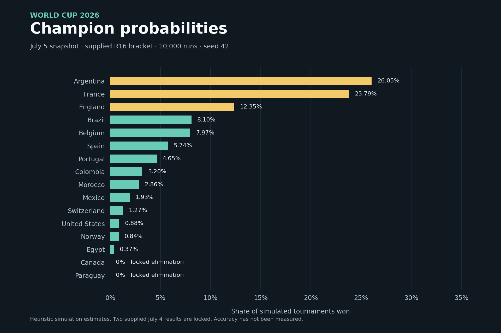

# World Cup 2026 Prediction Model

A personal sports analytics project by **Mahmood Algbory**, developed with AI assistance from Claude. Python combines six heuristic models into match probabilities; Monte Carlo simulation estimates how far each team can progress. An interactive HTML dashboard presents the results and a Flask API supports hypothetical matchups.

**Snapshot: start of July 5, 2026, at the Round of 16.** Only match results dated before July 5 are included. The knockout simulation uses the supplied 16-team bracket, including two locked July 4 results. This repository is a reproducible historical project scenario, with its assumptions documented below.



## Try the dashboard

Tested with **Python 3.12**. From the project folder:

```bash
python3 -m venv .venv
source .venv/bin/activate
python -m pip install -r requirements.txt
python api/predict_api.py
```

On Windows, activate the environment with `.venv\Scripts\Activate.ps1` in PowerShell. Open **http://127.0.0.1:5001/** in your browser. The same server serves the dashboard and the Matchup Tool; no API key is needed.

You can also open `scripts/wc2026_dashboard.html` directly to explore the precomputed probabilities. The Matchup Tool needs the local Flask server. Chart.js and the optional web font load from external CDNs; the tables remain available when those resources cannot load.

## What it includes

- Match win/draw/loss probabilities with per-model breakdowns and generated explanations.
- Champion odds and quarterfinal, semifinal, and final progression probabilities.
- 72 pairwise comparisons covering the project's 48-team group field.
- A read-only API with team validation and a frozen data cutoff.
- A seeded 10,000-run simulation with saved input and output files.

## How the model works

These are **handcrafted heuristic models**, with manually chosen formulas and weights. The project does not include a fitted machine learning model or evidence of predictive accuracy.

| Model | Signal | Base weight |
| --- | --- | ---: |
| Squad value | Positional market-value estimates and squad depth | 20% |
| Tactical | Derived playing styles and a manually defined clash matrix | 25% |
| Form/results | Recent scoring, defending, and match results | 15% |
| Quality form | Opponent-adjusted goal and pressing proxies | 15% |
| Momentum | Recent trends, streaks, and notable wins | 15% |
| Head-to-head | Historical meetings, with less influence when data is sparse | 10% |

For each matchup, `adjusted weight = base weight × model confidence`. Adjusted weights are normalized, then the three outcome probabilities are combined and normalized. **Confidence is an internal weighting score**, not a measured probability that a prediction is correct.

The knockout simulator samples match outcomes from these probabilities. A draw triggers an assumed extra-time process; a remaining draw is decided by a 50/50 penalty shootout. Known winners in the supplied bracket are locked. Every run follows the same supplied bracket slots. Champion and progression percentages are frequencies across the simulated tournaments.

## Reproduce this snapshot

From the project folder:

```bash
python scripts/run_all_groups.py
python scripts/generate_insights.py
python scripts/simulate_tournament.py --from-r16-bracket data/wc_actual_bracket_r16.json --runs 10000 --seed 42
python scripts/build_dashboard_data.py
python -m unittest discover -s tests -v
```

The results loader uses the bundled snapshot and never silently downloads newer matches. Seed 42 and 10,000 runs reproduce the published knockout output with the same code, inputs, and Python environment. Group comparisons use information available at the July 5 cutoff; they are **retrospective comparisons**, not recorded pre-tournament forecasts.

For a single command-line prediction:

```bash
python predict.py --home France --away Argentina
```

To regenerate the README chart, install `requirements-preview.txt`, then run `python scripts/plot_probabilities.py`.

## API

| Request | Result |
| --- | --- |
| `GET /` | Dashboard |
| `GET /predict?team1=France&team2=Argentina` | Match probabilities, six model outputs, weights, and explanation |
| `GET /metadata` | Snapshot cutoff, data provenance, seed, and run count |
| `GET /tournament_results` | Supplied results before the cutoff |

Missing, unknown, or identical teams return HTTP 400. Aliases such as `USA` resolve to `United States`. Legacy result logging and refresh endpoints return HTTP 410 because this demo is a fixed snapshot. The server binds to localhost with debugging disabled.

## Data and limits

See [data/README.md](data/README.md) for provenance and input definitions.

- The international results snapshot comes from [martj42/international_results](https://github.com/martj42/international_results), which publishes its results data under CC0-1.0. The bundled file is filtered to dates before July 5, 2026.
- Group and bracket definitions are supplied project inputs. They have not been independently checked against official fixtures.
- Squad values and rank assumptions are supplied estimates. Their original collection dates were not recorded, so the cutoff guarantee applies to match-result features; it does not establish historical availability of every squad estimate.
- The results dataset does not contain measured possession, shots, xG, or PPDA. Tactical and quality-form signals use proxies and fallbacks.
- Model signals overlap. Weights, host effects, extra-time behavior, and penalty assumptions have not been fitted or calibrated. Team ordering can affect matchup estimates.
- No time-based backtest, Brier score, log loss, or calibration analysis is included. Simulation frequency is not proof of forecast accuracy.

## Project layout

| Folder | Contents |
| --- | --- |
| `api/` | Local dashboard server and prediction API |
| `models/` | Six active models and the ensemble |
| `scripts/` | Simulation, data generation, dashboard, and chart |
| `data/` | Frozen results, squad estimates, brackets, and outputs |
| `docs/` | README probability chart |
| `tests/` | Cutoff, API, coverage, and reproducibility checks |

The bundled inputs are enough to run the main project. Optional legacy adapters and `build_squad_values.py` are retained as development utilities; their external keys and raw input files are not included. Set optional keys through environment variables rather than committing credentials.
